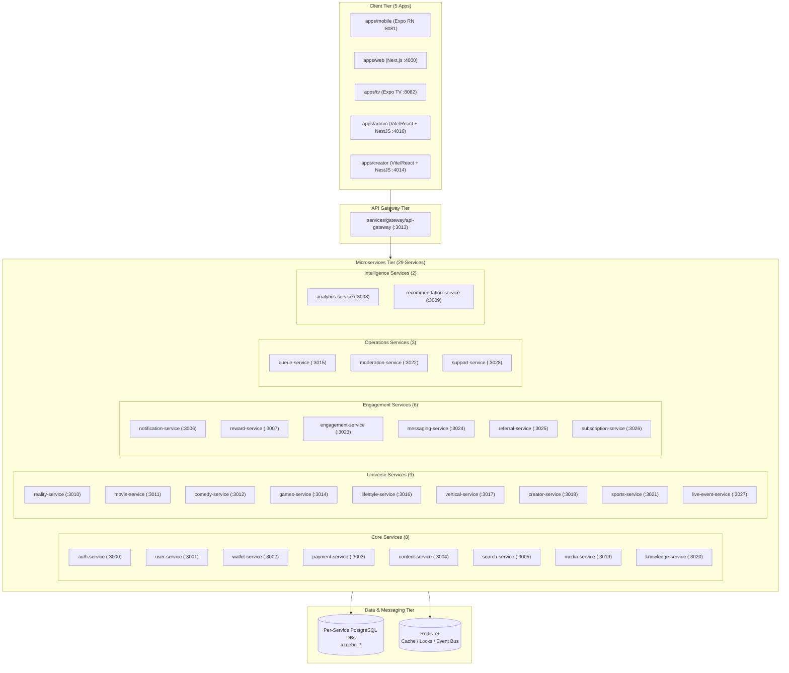

# Azeebo+ Platform Architecture

> Comprehensive architectural specification for the Azeebo+ digital entertainment platform.  
> **Version:** 1.0.0  
> **Last Updated:** September 28, 2026

---

## 1. Executive Summary

Azeebo+ is a modular digital entertainment platform built as a shared operating system powering multiple distinct content universes (Reality TV, Movies, Comedy, Games, Lifestyle, Vertical Video, Sports, Live Events, and Creator Content). The platform provides unified identity, virtual wallet economics, multi-tier subscription and pay-per-view monetization, real-time engagement, and knowledge graph capabilities across all universes.

---

## 2. High-Level Architecture

The platform follows an event-driven microservices architecture with isolated per-service databases, a unified API Gateway, shared library packages, and multi-platform client applications.



---

## 3. Client Applications (`apps/`)

Azeebo+ supports five client applications targeting mobile, desktop, TV, and governance experiences:

| Application | Directory | Framework & Stack | Port | Target Audience & Platform |
|-------------|-----------|-------------------|------|----------------------------|
| **mobile** | `apps/mobile` | Expo React Native (Expo Router) | 8081 | Consumers (iOS, Android) |
| **web** | `apps/web` | Next.js (App Router), Tailwind CSS | 4000 | Consumers & Web Viewers |
| **tv** | `apps/tv` | Expo React Native (TV runtime) | 8082 | Living Room (Android TV, Fire TV, Apple tvOS) |
| **admin** | `apps/admin` | Vite + React frontend, NestJS backend | 4016 | Internal Ops, Moderation, Platform Governance |
| **creator** | `apps/creator` | Vite + React frontend, NestJS backend | 4014 | Verified Creators, Uploads, Analytics & Payouts |

### TV Application Specifics
`apps/tv` is optimized for 10-foot UI experiences, D-pad navigation, QR code cross-device authentication linking (`/auth/device/link`), video streaming via `expo-video`, and low-latency catalog browsing.

---

## 4. Microservices Catalog (`services/`)

The platform comprises **29 microservices** partitioned into 6 functional groups:

### 4.1 Core Services (8 Services)
Foundation services providing identity, balances, content storage, search, and narrative knowledge.

| Service | Port | Database | Responsibilities |
|---------|------|----------|------------------|
| `auth-service` | 3000 | `azeebo_auth` | Authentication, JWT issue/verify, OAuth (Google/Apple), MFA, OTP, device link |
| `user-service` | 3001 | `azeebo_user` | User profile, preferences, social follows, watchlists, GDPR erasure |
| `wallet-service` | 3002 | `azeebo_wallet` | Virtual coin balances, atomic ledger transactions, row-locking debits/credits |
| `payment-service` | 3003 | `azeebo_payment` | Fiat payment gateways (Paystack, Flutterwave), webhook reconciliation, refunds |
| `content-service` | 3004 | `azeebo_content` | Central media catalog, metadata taxonomy, category tags, universal search feeds |
| `search-service` | 3005 | `azeebo_search` | Full-text search, pg_trgm indices, faceted filtering, auto-suggestions |
| `media-service` | 3019 | `azeebo_media` | S3 uploads, transcoding job dispatch, signed CDN URLs, thumbnail generation |
| `knowledge-service` | 3020 | `azeebo_knowledge` | Canonical narrative events, spoiler controls, knowledge unlock checkpoints |

### 4.2 Universe Services (9 Services)
Domain-specific microservices implementing unique entertainment models.

| Service | Port | Database | Responsibilities |
|---------|------|----------|------------------|
| `reality-service` | 3010 | `azeebo_reality` | Reality TV shows, voting rounds, supervotes, elimination predictions |
| `movie-service` | 3011 | `azeebo_movie` | Movie catalog, video-on-demand rentals, film premieres, watch passes |
| `comedy-service` | 3012 | `azeebo_comedy` | Standup specials, comedy challenges, skit feeds, comedian tipping |
| `games-service` | 3014 | `azeebo_games` | Trivia, interactive minigames, tournament leaderboards, prize pools |
| `lifestyle-service` | 3016 | `azeebo_lifestyle` | Fashion/culture stories, nightlife & venue guides, city polls |
| `vertical-service` | 3017 | `azeebo_vertical` | Short-form vertical series, episode progressions, interactive story branches |
| `creator-service` | 3018 | `azeebo_creator` | Creator profiles, onboarding verification, channels, revenue-share metrics |
| `sports-service` | 3021 | `azeebo_sports` | Sports tournament leagues, live match highlights, fan prediction contests |
| `live-event-service` | 3027 | `azeebo_live_event` | PPV live stream sessions, stage chats, virtual tickets, live telemetry |

### 4.3 Engagement Services (6 Services)
Social mechanics, notifications, rewards, and retention tools.

| Service | Port | Database | Responsibilities |
|---------|------|----------|------------------|
| `notification-service` | 3006 | `azeebo_notification` | Multi-channel dispatch (Push, WebSockets, Email SendGrid, SMS Twilio) |
| `reward-service` | 3007 | `azeebo_reward` | Gamification points, achievement badges, streak rewards, tier status |
| `engagement-service` | 3023 | `azeebo_engagement` | Likes, comments, reactions, watch-party sync, social share tracking |
| `messaging-service` | 3024 | `azeebo_messaging` | Direct in-app messaging, event channel chats, group threads |
| `referral-service` | 3025 | `azeebo_referral` | Viral referral link attribution, reward credit triggers, abuse detection |
| `subscription-service` | 3026 | `azeebo_subscription` | Platform & universe passes, recurring billing intervals, tier entitlements |

### 4.4 Operations Services (3 Services)
Backoffice processing, content safety, and user support.

| Service | Port | Database | Responsibilities |
|---------|------|----------|------------------|
| `queue-service` | 3015 | `azeebo_queue` | Background worker queue scheduling (BullMQ), asynchronous retries |
| `moderation-service` | 3022 | `azeebo_moderation` | Automated text/image analysis, flagged content review workflows, audit trails |
| `support-service` | 3028 | `azeebo_support` | Support ticketing system, agent routing, customer escalation workflows |

### 4.5 Intelligence Services (2 Services)
Data pipelines and personalization algorithms.

| Service | Port | Database | Responsibilities |
|---------|------|----------|------------------|
| `analytics-service` | 3008 | `azeebo_analytics` | Clickstream ingestion, event warehousing, KPI aggregations, audit logs |
| `recommendation-service` | 3009 | `azeebo_recommendation` | Collaborative filtering, universe discovery models, personalized feeds |

### 4.6 Gateway (1 Service)

| Service | Port | Database | Responsibilities |
|---------|------|----------|------------------|
| `api-gateway` | 3013 | None | Central reverse proxy, JWT authorization, rate-limiting, upstream routing |

---

## 5. Shared Libraries (`packages/`)

To prevent code duplication across 29 microservices and 5 client applications, Azeebo+ maintains **26 shared packages** structured under `packages/`:

### Core Libraries & Utilities
1. `@azeebo/shared-types`: Canonical TypeScript interfaces, DTOs, and enum types.
2. `@azeebo/utils`: Functional utilities, string formatting, date math, and array helpers.
3. `@azeebo/validation`: Reusable validation schemas, custom class-validator decorators, and Zod parsers.
4. `@azeebo/error-handling`: Standardized HTTP exception filters, RFC 7807 problem details, and error mappers.
5. `@azeebo/logger`: Structured JSON logger with correlation IDs and sensitive data redaction.

### Networking & Service Communication
6. `@azeebo/api-client`: Unified API SDK for client applications.
7. `@azeebo/http-client`: Resilient Axios/Fetch wrapper with exponential backoff and timeout handling.
8. `@azeebo/internal-clients`: Type-safe clients for service-to-service internal RPC over HTTP.
9. `@azeebo/event-bus`: Redis-backed pub/sub and stream-based asynchronous event dispatch.

### Security, Auth & Flags
10. `@azeebo/auth`: NestJS passport strategies, JWT decoding, and AuthGuard primitives.
11. `@azeebo/security`: Rate-limiting rules, HMAC signature validators, and encryption utilities.
12. `@azeebo/feature-flags`: Real-time Redis-backed feature flag client and rollout policies.
13. `@azeebo/flag-metrics`: Telemetry hooks for monitoring flag evaluation performance and drift.

### Frontend Primitives
14. `@azeebo/design-tokens`: Colors, typography scales, spacing tokens, and themes.
15. `@azeebo/ui`: Cross-platform component library (Web + React Native).
16. `@azeebo/react-data`: React Query hooks, query cache management, and data access layers.

### Observability & Infrastructure
17. `@azeebo/analytics-sdk`: Client and server event tracking SDK.
18. `@azeebo/observability`: Metrics collection, Prometheus scrapers, and health indicators.
19. `@azeebo/opentelemetry`: Distributed tracing instrumentation and W3C trace context propagation.
20. `@azeebo/model-cost-tracker`: LLM / AI token usage and inference cost monitoring.
21. `@azeebo/queue-policy`: BullMQ backoff policies, dead-letter queues, and concurrency configurations.
22. `@azeebo/shared-services`: Common NestJS modules (Prisma, Redis, Cache, Health, Terminus).

### Testing & Code Quality Tools
23. `@azeebo/test-utils`: Test fixtures, mock factories, and in-memory database helpers.
24. `@azeebo/contract-tests`: API contract verification and Pact/consumer-driven testing.
25. `eslint-rules`: Custom repository ESLint rules (preventing raw console logs, enforcing color tokens, etc.).
26. `monitoring`: Interceptors and metrics controllers for HTTP performance tracking.

---

## 6. Data Architecture

### 6.1 Database Isolation
Azeebo+ mandates strict database isolation. **Every service owns its own PostgreSQL database** named with the `azeebo_` prefix (e.g., `azeebo_wallet`, `azeebo_reality`). Direct cross-database joins or foreign keys between services are strictly prohibited. Inter-service data queries must occur via API endpoints or asynchronous event streams.

```
azeebo_auth          azeebo_user          azeebo_wallet        azeebo_payment
azeebo_content       azeebo_search        azeebo_media         azeebo_knowledge
azeebo_reality       azeebo_movie         azeebo_comedy        azeebo_games
azeebo_lifestyle     azeebo_vertical      azeebo_creator       azeebo_sports
azeebo_live_event    azeebo_notification  azeebo_reward        azeebo_referral
azeebo_messaging     azeebo_engagement    azeebo_subscription  azeebo_queue
azeebo_support       azeebo_moderation    azeebo_analytics     azeebo_recommendation
azeebo_admin         azeebo_creator
```

### 6.2 Concurrency & Financial Safety
All financial and virtual wallet transactions employ a two-tier concurrency control model:
1. **Redis Distributed Mutex:** Short-lived locks on `wallet:{userId}` with 5-second TTL.
2. **Pessimistic Row-Level Locking:** PostgreSQL `SELECT ... FOR UPDATE` inside atomic transactions.
3. **Idempotency Keys:** Mandatory `X-Idempotency-Key` headers on all balance-altering endpoints.

---

## 7. Developer & Build Workflows

The monorepo uses `pnpm` workspaces with standardized build and dev runners:
- `scripts/start-dev-service.sh`: Shared dev runner for all 29 backend microservices.
- `scripts/build-service.sh`: Shared compiler for all NestJS microservices.
- `scripts/start-dev-app.sh`: Dev runner for schema-owning apps (`apps/admin`, `apps/creator`).
- `scripts/build-package.sh`: Shared compile-only runner for shared libraries.
- `scripts/local-dev.sh`: Comprehensive orchestrator for local multi-database setup, migrations, seeds, and service processes.

---

## 8. Cross-Reference Documentation

- [CLAUDE.md](./CLAUDE.md): Engineering rules, coding conventions, and agent instructions.
- [docs/SERVICES.md](./docs/SERVICES.md): Full microservice endpoint catalog and API documentation.
- [docs/DEVELOPER-GUIDE.md](./docs/DEVELOPER-GUIDE.md): Developer onboarding and day-to-day workflow.
- [docs/DEPLOYMENT.md](./docs/DEPLOYMENT.md): Deployment instructions and production environment setup.
- [docs/AGENTS.md](./docs/AGENTS.md): Multi-agent architecture and agent pipeline.
- [CHECKS.md](./CHECKS.md): CI/CD compliance checks and invariant enforcement.
