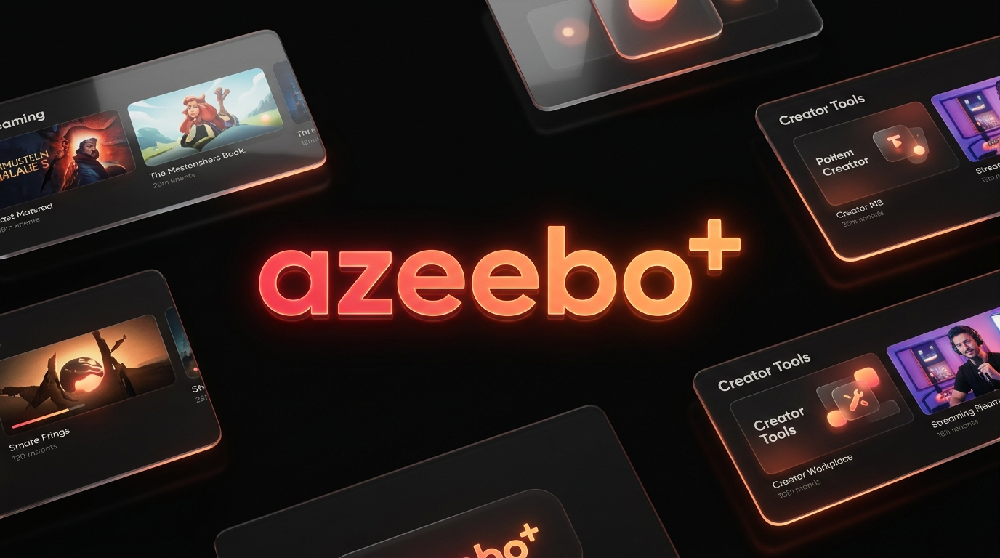

# Azeebo+ Brand Identity & Guidelines

> Official Brand Identity Standards, Logo System, Typography, Layout, and Component Specs.

---

## 1. Brand Essence & Vision

**Azeebo+** is the premier digital entertainment powerhouse uniting African creativity with global scale. We bridge Nollywood cinema, reality television, creator-led content, live sports, and gamified interactive voting under one unified experience.

### Core Brand Pillars

1. **Electric Energy**: Dynamic, passionate, and high-tempo entertainment.
2. **Obsidian Luxury**: Sleek, distraction-free **Vanta Black** dark environments that elevate content.
3. **Seamless Interactivity**: Live voting, predictions, tipping, and creator fan-clubs built right into playback.
4. **Authentic Culture**: Celebrating African storytelling with world-class engineering and cinema fidelity.

---

## 2. Master Brand Showcase

---

## 3. Logo Architecture & Usage

### 3.1 Primary Logomark
The Azeebo+ logo features custom heavy rounded lowercase letterforms paired with an energetic rotating energy swirl in the letter `o` and a glowing spark symbol.

- **Primary Logo:** `brand/assets/logo-primary.svg`
- **Icon Mark:** `brand/assets/logo-symbol.svg`

### 3.2 Clear Space & Sizing
- **Minimum Clear Space:** Equal to the height of the letter `a` on all four sides.
- **Minimum Digital Size:**
  - Full Logotype: `120px` width (web) / `100px` width (mobile header).
  - Standalone Symbol: `28px × 28px` (favicon/tab bar) / `48px × 48px` (app launcher).

### 3.3 Usage Rules
- ✅ **DO**: Use the full sunset gradient (`#E5251C` → `#F3501A` → `#FFA02E`) on pure `#050505` Vanta Black backgrounds.
- ✅ **DO**: Use the monochrome white logo (`#FFFFFF`) on dense video thumbnails or complex visual banners.
- ❌ **DON'T**: Place the gradient logo on bright or low-contrast backgrounds without a dark scrim.
- ❌ **DON'T**: Distort, rotate, stretch, or alter the typography kerning.
- ❌ **DON'T**: Change the angle of the flame gradient (always 135° or horizontal left-to-right).

---

## 4. Typography System

We use modern, high-legibility geometric sans-serif typography:

- **Primary Display & Headings:** `Montserrat` / `Poppins` (Bold `700`, Extrabold `800`, Black `900`)
- **Body & UI Controls:** `Inter` / `System Sans` (Regular `400`, Medium `500`, Semibold `600`)
- **Monospace & Numbers:** `JetBrains Mono` / `SF Mono` (for coin balances, timers, code stats)

### Type Scale

| Level | Size (Mobile) | Size (Desktop) | Weight | Line Height | Tracking |
|:---|:---|:---|:---|:---|:---|
| **Display Hero** | `32px` | `56px` | 900 | 1.1 | -0.03em |
| **Heading 1** | `24px` | `36px` | 800 | 1.2 | -0.02em |
| **Heading 2** | `20px` | `28px` | 700 | 1.25 | -0.01em |
| **Heading 3** | `17px` | `22px` | 600 | 1.3 | 0 |
| **Body Large** | `15px` | `16px` | 400 / 500 | 1.5 | 0 |
| **Body Default** | `13px` | `14px` | 400 | 1.5 | +0.01em |
| **Caption / Meta**| `11px` | `12px` | 500 | 1.4 | +0.02em |

---

## 5. UI Component Design Specifications

### 5.1 Glassmorphism Content Cards
- **Background:** `rgba(15, 15, 20, 0.72)`
- **Backdrop Blur:** `20px`
- **Border:** `1px solid rgba(255, 255, 255, 0.08)`
- **Corner Radius:** `16px` (Web) / `14px` (Mobile)
- **Hover State:** Translate Y `-2px`, Border `rgba(255, 255, 255, 0.18)`, Box Shadow `0 20px 40px rgba(0, 0, 0, 0.85)`

### 5.2 Primary Flame CTA Button
- **Background:** `linear-gradient(135deg, #E5251C 0%, #F3501A 38%, #FF6B00 72%, #FFA02E 100%)`
- **Text Color:** `#FFFFFF` (Font weight 700)
- **Border Radius:** `9999px` (Full Pill)
- **Padding:** `14px 32px` (Web) / `12px 24px` (Mobile)
- **Glow Shadow:** `0 0 24px rgba(243, 80, 26, 0.35)`

### 5.3 Live Voting & Gamification Widget
- **Background:** `rgba(21, 21, 28, 0.9)`
- **Active Contestant Border:** `2px solid #FF3366` (Reality Neon)
- **Vote Progress Bar:** `linear-gradient(90deg, #E5251C, #FF6B00)`
- **Coin Badge:** Gold Amber `#FFA02E` pill with subtle pulse glow

---

## 6. Imagery & Photography Guidelines

- **High Contrast Cinematic Treatment**: Video posters, hero banners, and creator portraits should feature deep ambient lighting, dramatic contrast, and rich color saturation.
- **Dark Bottom Scrim**: Always overlay a bottom gradient scrim (`linear-gradient(180deg, transparent 0%, rgba(5, 5, 5, 0.85) 80%, #050505 100%)`) beneath video posters so text titles remain 100% legible.
- **Rounded Thumbnails**: All media cards use a standard `12px` or `16px` border radius with hairline border `rgba(255, 255, 255, 0.06)`.
