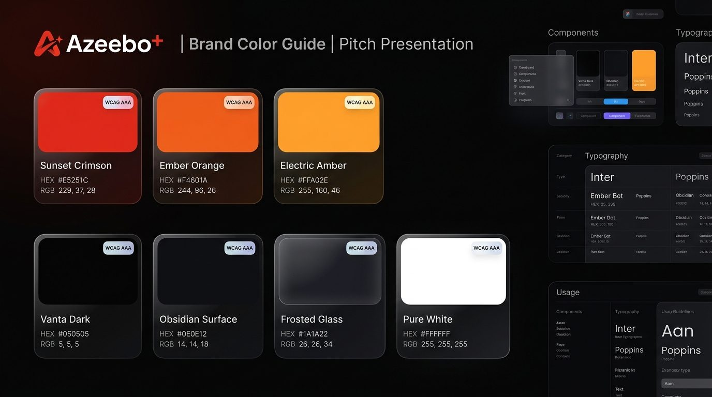

# Azeebo+ Color System Specification

> Master color palette, exact logo gradient extraction, Vanta Black OLED matrix, and WCAG accessibility standards.

---

## 1. Extracted Brand Logo Palette

Extracted with precision from the official **Azeebo** brand logomark:



```
       #E5251C           #F3501A           #FF6B00           #FFA02E
   [Sunset Crimson] → [Ember Scarlet] → [Electric Flame] → [Sunset Amber]
      (Stop 0%)          (Stop 38%)         (Stop 72%)        (Stop 100%)
```

### Exact Color Values

| Token Name        | Hex Code  | RGB            | HSL            | Role & Usage                                            |
| :---------------- | :-------- | :------------- | :------------- | :------------------------------------------------------ |
| `--brand-crimson` | `#E5251C` | `229, 37, 28`  | `3° 81% 50%`   | Logo origin stop, active button states, urgent badges   |
| `--brand-scarlet` | `#F3501A` | `243, 80, 26`  | `15° 90% 53%`  | **Primary Brand Color**, hero CTAs, main action links   |
| `--brand-flame`   | `#FF6B00` | `255, 107, 0`  | `25° 100% 50%` | Brand hover states, notification badges, active icons   |
| `--brand-amber`   | `#FFA02E` | `255, 160, 46` | `33° 100% 59%` | Highlight glow, coin/reward indicators, spark terminals |
| `--brand-coral`   | `#FA8128` | `250, 129, 40` | `25° 95% 57%`  | Pill badges, micro-tags, secondary gradients            |

---

## 2. Master Brand Gradients

```css
/* Core Primary CTA Flame */
--gradient-brand-flame: linear-gradient(135deg, #e5251c 0%, #f3501a 38%, #ff6b00 72%, #ffa02e 100%);

/* Subtle Ambient Glow */
--gradient-vanta-glow: radial-gradient(
  circle at top center,
  rgba(243, 80, 26, 0.18) 0%,
  rgba(5, 5, 5, 0) 70%
);

/* Video Player Cinema Scrim */
--gradient-cinema-scrim: linear-gradient(
  180deg,
  transparent 0%,
  rgba(5, 5, 5, 0.6) 60%,
  #050505 100%
);

/* Glass Card Background Gradient */
--gradient-glass-surface: linear-gradient(
  180deg,
  rgba(255, 255, 255, 0.05) 0%,
  rgba(255, 255, 255, 0.01) 100%
);
```

---

## 3. Vanta Black True OLED Dark Mode Matrix

Replacing dull washed-out greys (`#1F2937` or `#111827`) with true deep-space **Vanta Black** (`#050505`) and layered obsidian surfaces:

```
┌─────────────────────────────────────────────────────────────┐
│ Level 3: Active Hover / Segmented Controls (#1C1C26)         │
│   ┌─────────────────────────────────────────────────────┐   │
│   │ Level 2: Elevated Dialogs & Floating Bars (#15151C)  │   │
│   │   ┌─────────────────────────────────────────────┐   │   │
│   │   │ Level 1: Cards & Content Modules (#0F0F14)  │   │   │
│   │   │   ┌─────────────────────────────────────┐   │   │   │
│   │   │   │ Level 0: Vanta Void Canvas (#050505)│   │   │   │
│   │   │   └─────────────────────────────────────┘   │   │   │
│   │   └─────────────────────────────────────────────┘   │   │
│   └─────────────────────────────────────────────────────┘   │
└─────────────────────────────────────────────────────────────┘
```

| Layer              | Token Name              | Hex Code  | Opacity / Elevation | Purpose                                         |
| :----------------- | :---------------------- | :-------- | :------------------ | :---------------------------------------------- |
| **Void Canvas**    | `--vanta-black`         | `#050505` | 100% (Base)         | Main viewport canvas, 0% OLED power consumption |
| **Deep Underlay**  | `--vanta-surface-0`     | `#09090C` | 100%                | Section separators, media backdrops             |
| **Content Cards**  | `--vanta-surface-1`     | `#0F0F14` | 100% (Glass 72%)    | Video cards, feed items, list containers        |
| **Elevated Modal** | `--vanta-surface-2`     | `#15151C` | 100% (Glass 85%)    | Modals, bottom sheets, dropdown popovers        |
| **Active States**  | `--vanta-surface-3`     | `#1C1C26` | 100%                | Hover overlays, active tab highlights, chips    |
| **Input Fields**   | `--vanta-surface-input` | `#111116` | 100%                | Text inputs, search bars, textarea fills        |

---

## 4. Typography & High-Contrast Readability

Tested rigorously against `#050505` for WCAG 2.1 AAA accessibility:

| Token Name               | Hex Code  | Contrast vs `#050505` | WCAG Rating                                         | Usage                                      |
| :----------------------- | :-------- | :-------------------- | :-------------------------------------------------- | :----------------------------------------- |
| `--text-vanta-primary`   | `#FFFFFF` | **20.4:1**            | AAA                                                 | Headings, hero titles, primary button text |
| `--text-vanta-secondary` | `#CBD5E1` | **13.7:1**            | AAA                                                 | Body text, card descriptions, navigation   |
| `--text-vanta-tertiary`  | `#94A3B8` | **8.0:1**             | AAA                                                 | Timestamps, metadata, inactive labels      |
| `--text-vanta-muted`     | `#6A778E` | **4.5:1**             | AA (body text; clears the 4.5:1 threshold narrowly) | Placeholders, subtle captions              |
| `--text-vanta-accent`    | `#FF6B00` | **7.1:1**             | AAA                                                 | Active filters, verified badges, links     |

---

## 5. Universe Thematic Accents

Every entertainment universe on Azeebo+ pairs harmoniously with the Vanta Black base:

| Universe               | Primary Accent              | Glow Variable               | Contrast vs `#050505`      | Vibe / Character                            |
| :--------------------- | :-------------------------- | :-------------------------- | :------------------------- | :------------------------------------------ |
| **Reality & Voting**   | `#FF3366` (Neon Pink)       | `rgba(255, 51, 102, 0.35)`  | 5.7:1                      | High-energy, suspenseful, competitive       |
| **Creator Hub**        | `#00E5FF` (Cyan Glow)       | `rgba(0, 229, 255, 0.35)`   | 13.3:1                     | Digital-first, tech-forward, creator-led    |
| **Azeebo Cinema**      | `#FFA02E` (Gold Amber)      | `rgba(255, 160, 46, 0.35)`  | 10.0:1                     | Prestige, Hollywood/Nollywood gold standard |
| **Comedy & Shows**     | `#FFD600` (Electric Yellow) | `rgba(255, 214, 0, 0.35)`   | 14.4:1                     | Playful, bold, vibrant                      |
| **Live Sports**        | `#00E676` (Sprint Green)    | `rgba(0, 230, 118, 0.35)`   | 12.2:1                     | Dynamic, realtime, energetic                |
| **Play & Win (Games)** | `#B388FF` (Electric Purple) | `rgba(179, 136, 255, 0.35)` | 7.7:1                      | Arcade, futuristic, rewards                 |
| **Shorts & Reels**     | `#FF007A` (Hyper Magenta)   | `rgba(255, 0, 122, 0.35)`   | 5.4:1 (fails AA body text) | Fast-paced, addictive, viral                |

---

## 6. Glassmorphism & Lighting Formula

```css
/* Premium Obsidian Frosted Glass */
.vanta-glass-panel {
  background: rgba(15, 15, 20, 0.72);
  backdrop-filter: blur(20px) saturate(180%);
  -webkit-backdrop-filter: blur(20px) saturate(180%);
  border: 1px solid rgba(255, 255, 255, 0.08);
  box-shadow:
    0 10px 30px -5px rgba(0, 0, 0, 0.8),
    0 0 1px 1px rgba(255, 255, 255, 0.05);
}

/* On Focus / Active State */
.vanta-glass-panel:focus-within,
.vanta-glass-panel.is-active {
  border-color: rgba(243, 80, 26, 0.45);
  box-shadow:
    0 10px 30px -5px rgba(0, 0, 0, 0.8),
    0 0 25px rgba(243, 80, 26, 0.25);
}
```
