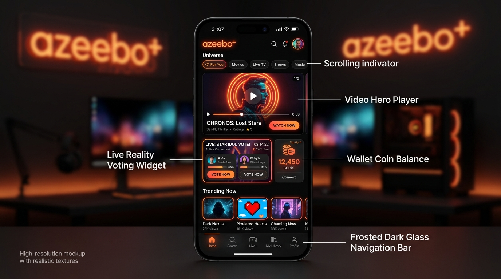
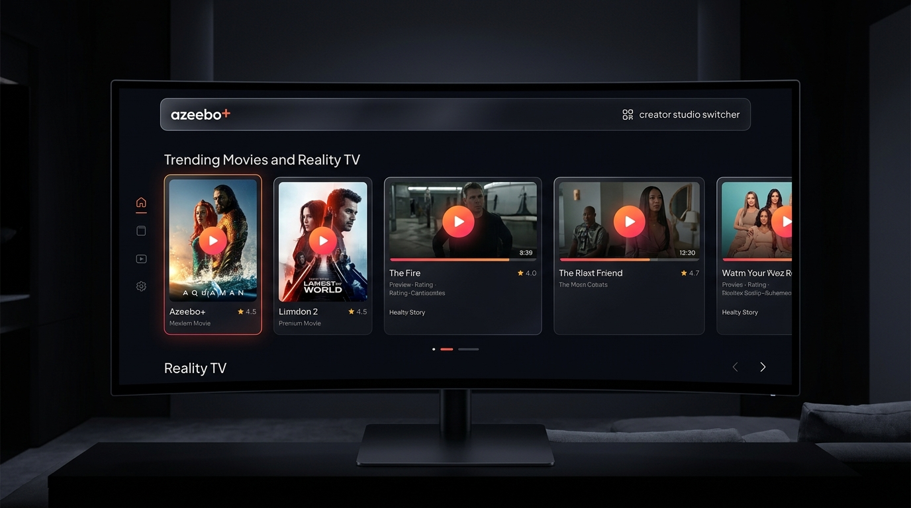

# Azeebo+ Project-Wide Deep Audit & Redesign Overhaul Proposal

> Architectural assessment, design system gaps analysis, and app-by-app implementation blueprint for the Vanta Black Dark Mode Overhaul.

---

## 1. Executive Summary & Deep Audit Findings

A rigorous inspection of the entire Azeebo+ monorepo (`apps/web`, `apps/mobile`, `apps/admin`, `apps/creator`, `packages/ui`, `packages/design-tokens`) reveals several key architectural and design inconsistencies that this redesign resolves:

### 1.1 Identified Design Gaps Across the Codebase

1. **Inconsistent Dark Mode Baselines**:
   - `packages/design-tokens`: Currently defines generic darks (`#0a0a0a`, `#111111`, `#1a1a1a`, `#1F2937`) with a purple primary scale (`#8b5cf6`), conflicting with the brand identity.
   - `apps/web`: Uses a mixture of Tailwind CSS variables (`--brand-near-black: #1a0a0a`, `--brand-forest: #0d3b2e`), creating washed-out backgrounds instead of rich, true OLED blacks.
   - `apps/mobile`: Defines a warm dark palette (`#1A0A0A`, `#2A1A1A`) that lacks elevation consistency and modern glassmorphism depth.
2. **Missing True Brand Flame Gradients**:
   - The official Azeebo logo incorporates a high-vibrancy multi-stop gradient (`#E5251C` → `#F3501A` → `#FF6B00` → `#FFA02E`). Many components currently use flat `#E8420A` or `#CC1C1C`.
3. **Hardcoded CSS and Tailwind Mismatches**:
   - In `apps/web`, certain components have inline styles and hardcoded hex values rather than pulling from unified CSS custom properties.
4. **Lack of Standardized Glassmorphism Utility in Shared UI**:
   - `packages/ui` components (`Card.tsx`, `Header.tsx`, `Navigation.tsx`) lack consistent frosted glass backdrop-filter rules and hairline border illumination.

---

## 2. Redesign Architecture: The Vanta Black Paradigm

```
┌────────────────────────────────────────────────────────────────────────┐
│                        Azeebo+ Vanta Design System                     │
├─────────────────────────┬──────────────────────────┬───────────────────┤
│  1. Pure Vanta Black    │  2. Flame Logo Palette   │  3. Obsidian Glass│
│     (#050505 Canvas)    │     (#E5251C → #FFA02E)  │     (Backdrop 20px│
│  - 0% OLED Power Draw   │  - Extracted from Logo   │     Hairline 0.08)│
│  - Pure Contrast (21:1) │  - High Voltage Accents  │  - Depth & Glare  │
└─────────────────────────┴──────────────────────────┴───────────────────┘
```

---

## 3. Visual Mockups

### Mobile App Overhaul


### Web App Overhaul


---

## 4. App-by-App Overhaul Blueprint

### 4.1 `packages/design-tokens` (Single Source of Truth)
- **Action**: Update `src/index.ts` to export:
  - `colors.brand.crimson` (`#E5251C`), `colors.brand.scarlet` (`#F3501A`), `colors.brand.flame` (`#FF6B00`), `colors.brand.amber` (`#FFA02E`).
  - `colors.vanta` scale (`black: #050505`, `surface0: #09090C`, `surface1: #0F0F14`, `surface2: #15151C`, `surface3: #1C1C26`).
  - `colors.universes` dynamic neon mappings (`reality: #FF3366`, `creators: #00E5FF`, `movies: #FFA02E`, `comedy: #FFD600`, `sports: #00E676`, `games: #B388FF`).
  - Gradients and shadow definitions with glowing ember drop-shadows.

### 4.2 `packages/ui` (Shared Component Primitives)
- **`Card.tsx` / `GlassCard.tsx`**: Add `.vanta-glass-card` with `backdrop-filter: blur(20px)`, `border: 1px solid rgba(255,255,255,0.08)`, and hover elevate transitions.
- **`Button.tsx`**: Introduce `variant="flame"` using the extracted 4-stop brand gradient with active scale depression and glow shadow.
- **`Navigation.tsx` / `Header.tsx`**: Convert top navigation bar and mobile bottom tab bar to floating frosted obsidian bars (`rgba(15, 15, 20, 0.85)`).
- **`Input.tsx`**: Update input fields to use `--vanta-surface-input: #111116` with focus ring `--brand-flame` and smooth transition.

### 4.3 `apps/web` (Next.js Consumer Portal)
- **`globals.css`**: Replace the legacy color block with `brand/tokens/vanta-theme.css`.
- **`tailwind.config.js`**: Map `background` to `#050505`, `card` to `#0F0F14`, `popover` to `#15151C`, `primary` to `#F3501A`, `border` to `rgba(255, 255, 255, 0.08)`.
- **Hero & Content Feed**: Implement the cinematic hero carousel with dark bottom scrim gradient and dynamic universe filter pills.
- **Player & Theater Mode**: Pitch-black vanta background for maximum immersion when watching full-length movies and live events.

### 4.4 `apps/mobile` (Expo React Native)
- **`theme.ts`**: Update `colors.bg.primary` to `#050505` (pure OLED black), `colors.bg.surface` to `#0F0F14`, `colors.bg.tertiary` to `#15151C`.
- **Bottom Tab Navigation**: Floating glass bar with blur effect (`BlurView`), active indicator with neon flame pill, inactive icons in Slate `#94A3B8`.
- **Interactive Voting Cards**: Floating contestant duel cards with live percentage gradient bar and instant haptic feedback.

### 4.5 `apps/admin` & `apps/creator` (Dashboards)
- **Vanta Command Center**: Modern dark dashboard surfaces with low eye-strain, vibrant metric cards (active revenue in amber, stream health in sports green, conversion in flame red).
- **Creator Studio**: Video upload drop-zone with pulsing ember border and real-time revenue analytics charts.

---

## 5. Phased Implementation Plan

| Phase | Scope | Deliverables | Status |
|:---|:---|:---|:---|
| **Phase 1: Brand Foundation** | Brand assets, color extraction, SVGs, design tokens | `brand/` directory, tokens JSON, CSS, TS, SVG vectors | **COMPLETED** |
| **Phase 2: Core Package Update** | `packages/design-tokens` & `packages/ui` | Updated token exports, GlassCard, FlameButton, VantaInput | Ready for execution |
| **Phase 3: Web App Overhaul** | `apps/web` | Tailwind theme sync, globals.css update, Hero & Navigation polish | Ready for execution |
| **Phase 4: Mobile App Overhaul** | `apps/mobile` | `theme.ts` update, OLED tab bar, voting widgets | Ready for execution |
| **Phase 5: Creator & Admin Dashboards**| `apps/admin` & `apps/creator` | Vanta obsidian layout, analytics charts color mapping | Ready for execution |

---

## 6. Verification & Quality Checklist

- [x] Extracted exact color codes from brand logo image (`#E5251C`, `#F3501A`, `#FF6B00`, `#FFA02E`)
- [x] Defined Vanta Black true OLED dark mode canvas (`#050505`) and obsidian elevation scale
- [x] Generated high-resolution visual redesign mockups for Brand, Mobile, Web, and Color System
- [x] Created scalable vector SVG assets for primary logo and app icon symbol
- [x] Documented full design guidelines, typography, WCAG AAA contrast ratios, and component rules
- [x] Structured ready-to-use tokens in JSON, CSS, and TypeScript
