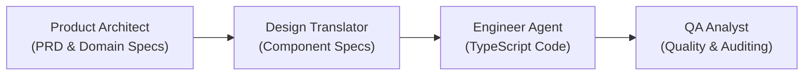

# Azeebo+ Multi-Agent Architecture

> Specification and operational guide for the AI-assisted development multi-agent pipeline in the Azeebo+ monorepo.

---

## 1. Overview

Azeebo+ utilizes an agentic development methodology where specialized AI agents handle discrete phases of the software development lifecycle. Agents work in a defined sequence or independently, following platform architectural patterns, security requirements, and UI/UX design tokens.

---

## 2. Agent Registry

| Agent | Purpose | Context Files | Primary Outputs |
|-------|---------|---------------|-----------------|
| **Product Architect** | Converts ideas, feature requests, and universe concepts into structured PRDs | `CLAUDE.md`, `ARCHITECTURE.md`, `docs/SERVICES.md` | Problem statement, user stories, acceptance criteria, database schema proposals, API needs |
| **Design Translator** | Translates Figma designs, UI wireframes, and UX intent into component specifications | `CLAUDE.md`, `packages/design-tokens`, `packages/ui` | Layout specs, component inventory, full state matrix (loading, empty, error, success), tokens mapping |
| **Engineer** | Implements production-ready full-stack TypeScript code matching platform standards | `CLAUDE.md`, `ARCHITECTURE.md`, `docs/SERVICES.md` | NestJS controllers & modules, React Native/Next.js screens, Prisma migrations, unit tests |
| **QA Analyst** | Validates code quality, generates test plans, identifies edge cases, and audits security | `CLAUDE.md`, `ARCHITECTURE.md`, `CHECKS.md` | Test matrices, payment safety checklists, WCAG accessibility audits, edge case reports |

---

## 3. Agent Detailed Specifications

### 3.1 Product Architect
- **Role:** Converts business and entertainment universe requirements into engineering-ready specifications.
- **When to Use:**
  - Planning new features or expanding universes (e.g., new voting mechanic, tournament type).
  - Designing monetization mechanics (virtual coins, passes, subscriptions).
- **Core Checklist:**
  - Clear user stories with strict acceptance criteria.
  - Entity-relationship definitions mapped to per-service databases (`azeebo_*`).
  - Analytics event definitions following `snake_case` taxonomy.
  - Rate-limiting, concurrency, and fraud vectors.

### 3.2 Design Translator
- **Role:** Converts visual designs and interaction intent into technical component specs.
- **When to Use:**
  - Transforming screen designs into frontend implementations (`apps/mobile`, `apps/web`, `apps/tv`, `apps/admin`, `apps/creator`).
  - Specifying cross-platform components for `@azeebo/ui`.
- **Core Checklist:**
  - Token compliance: Strictly use `@azeebo/design-tokens` (no arbitrary hex colors or pixel values).
  - State completeness: Explicit specs for `default`, `hover`, `active`, `focus-visible`, `disabled`, `loading`, `error`, and `empty` states.
  - Multi-form factor responsiveness: Mobile (touch), Web (responsive), TV (10-ft UI, D-pad navigation).

### 3.3 Engineer
- **Role:** Implements production-ready code across microservices, shared libraries, and client apps.
- **When to Use:**
  - Developing NestJS endpoints, controllers, services, and modules.
  - Building screens and hooks in Expo React Native, Next.js, or Vite.
  - Creating and running Prisma migrations.
  - Refactoring shared functionality into `packages/*`.
- **Core Principles:**
  - Strict TypeScript (no `any`).
  - Zero cross-service database coupling.
  - Idempotency and atomic locking for all wallet/payment mutations.
  - Standardized JSON logging via `@azeebo/logger`.

### 3.4 QA Analyst
- **Role:** Quality assurance, risk auditing, test automation, and release readiness.
- **When to Use:**
  - Pre-merge code quality reviews.
  - Financial safety audits on wallet, payment, and tipping flows.
  - Regression testing and edge case identification.
- **Core Checklist:**
  - Concurrency safety (race conditions, double-spend vulnerabilities).
  - WCAG 2.2 AA accessibility validation.
  - Analytics event emission verification.
  - Performance budgets and payload sizes.

---

## 4. Collaboration Workflows

### 4.1 New Feature Pipeline
1. **Product Architect** crafts the feature specification and API contracts.
2. **Design Translator** specifies the UI components, tokens, and state transitions.
3. **Engineer** generates code across backend microservices and client apps.
4. **QA Analyst** audits test coverage, verifies financial safety, and runs CI checks.

### 4.2 Bug Fix & Remediation Workflow
1. **QA Analyst** isolates reproduction steps and identifies edge cases.
2. **Engineer** applies the targeted fix and adds regression unit tests.
3. **QA Analyst** verifies fix resolution and confirms no invariant violations.

---

## 5. References

- [Root AGENTS.md](../AGENTS.md) - Platform agent definitions
- [ARCHITECTURE.md](../ARCHITECTURE.md) - System architecture
- [CLAUDE.md](../CLAUDE.md) - Engineering rules and invariants
- [CHECKS.md](../CHECKS.md) - CI/CD compliance checks
