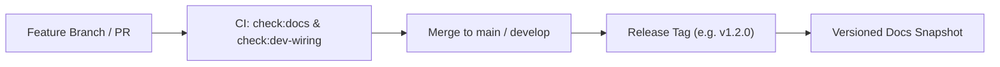

# Azeebo+ Documentation Release & Versioning Process

> Lifecycle policy, review cadence, and release procedures for platform documentation.  
> **Version:** 1.0.0  
> **Effective Date:** September 28, 2026

---

## 1. Overview

Documentation in Azeebo+ is treated with the same engineering rigor as production software. Every microservice, frontend application, and shared package must maintain synchronized documentation. This document specifies the process for releasing versioned documentation alongside software releases.

---

## 2. Release Alignment & Cadence

Documentation releases are coupled to platform release tags (`vX.Y.Z`):



| Release Type | Trigger | Documentation Action |
|--------------|---------|----------------------|
| **Major (vX.0.0)** | Breaking API changes, architectural shifts, new universes | Full audit of `ARCHITECTURE.md`, `docs/SERVICES.md`, and migration runbooks |
| **Minor (vX.Y.0)** | New microservice, new endpoints, new client app, new shared package | Update `SERVICES.md`, `README.md`, `CLAUDE.md`, run `pnpm run check:docs` |
| **Patch (vX.Y.Z)** | Bug fixes, internal refactoring, non-breaking schema tweaks | Keep endpoint documentation current; update bug fix runbooks |

---

## 3. Pre-Release Documentation Checklist

Before cutting any release tag:

1. **Automated Verification:**
   ```bash
   pnpm run check:docs
   pnpm run check:flags:docs
   pnpm run check:dev-wiring
   pnpm run check:env
   ```
2. **Endpoint Parity Check:**
   - Ensure all `@Controller()` routes in `services/*` match entries in `docs/SERVICES.md`.
3. **Database Schema Parity:**
   - Ensure any new Prisma models or migrations are recorded in service READMEs.
4. **Environment Variables:**
   - Verify that all newly introduced environment variables are documented in `.env.example` and `docs/DEPLOYMENT.md`.
5. **Changelog & Release Notes:**
   - Document any breaking contract changes or deprecations according to `docs/DEPRECATION_POLICY.md`.

---

## 4. Documentation Ownership & Approvals

- **Core & Operations Services:** Platform Lead / Architect approval required.
- **Universe Services:** Universe Lead approval required.
- **Frontend Clients:** Frontend Architecture Lead approval required.
- **Shared Libraries:** Core Infrastructure Lead approval required.

---

## 5. Automated CI Invariant Checks

The following automated checks run on every PR to prevent documentation drift:
- `pnpm run check:docs`: Enforces that all 29 services, 5 apps, and 26 packages are present across `ARCHITECTURE.md`, `README.md`, `CLAUDE.md`, and `docs/SERVICES.md`.
- `pnpm run check:flags:docs`: Ensures feature flag registry documentation is completely synchronized with code definitions.
