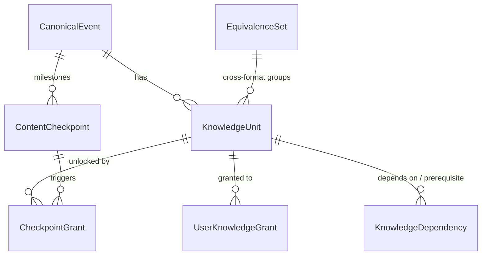

# Knowledge Service (`@azeebo/knowledge-service`)

> Core knowledge graph service managing canonical narrative events, spoiler filtering, user knowledge grants, checkpoint triggers, and reader projections.

- **Port:** 3020
- **Database:** `azeebo_knowledge` (PostgreSQL)
- **Service Name:** `knowledge-service`
- **Location:** `services/core/knowledge-service`

---

## 1. Overview & Architecture

The Knowledge Service acts as the canonical narrative source of truth for storyworlds across Azeebo+ (particularly serialized storylines, transmedia universes, and interactive media). It prevents spoilers, tracks what each user has unlocked or learned across different formats, and projects customized viewing/reading states.

---

## 2. Prisma Database Schema & Data Models

The Prisma schema is located at `prisma/schema.prisma`.

### 2.1 Core Models



1. **`CanonicalEvent` (`canonical_events`)**
   - **Purpose:** Represents indisputable facts that occurred within a universe (e.g., episode air dates, tournament results, character milestones).
   - **Key Fields:** `id` (UUID), `eventCode` (unique slug, e.g. `S03E02_AIR_DATE`), `title`, `description`, `universeId`, `eventDate`, `metadata` (JSON), `version`.
   - **Relations:** 1-to-many with `KnowledgeUnit`, `KnowledgeDependency`, and `ContentCheckpoint`.

2. **`KnowledgeUnit` (`knowledge_units`)**
   - **Purpose:** Atomic piece of narrative knowledge a user can acquire.
   - **Key Fields:** `id`, `canonicalEventId`, `title`, `description`, `knowledgeType` (`fact`, `character`, `plot_point`, `location`, `timeline`), `spoilerLevel` (`none`, `mild`, `major`, `severe`), `metadata`, `version`.
   - **Relations:** Belongs to `CanonicalEvent` and optional `EquivalenceSet`.

3. **`KnowledgeDependency` (`knowledge_dependencies`)**
   - **Purpose:** Direct acyclic graph (DAG) specifying prerequisites between knowledge units (e.g. Unit A must be learned before Unit B is unlocked).
   - **Key Fields:** `dependsOnEventId`, `dependsOnUnitId`, `dependentEventId`, `dependentUnitId`, `dependencyType` (`prerequisite`, `contextual`, `enhancement`).

4. **`ContentCheckpoint` (`content_checkpoints`)**
   - **Purpose:** Media timestamp or milestone in a piece of content (e.g. at 24:15 in Episode 2) that triggers knowledge unlocks.
   - **Key Fields:** `contentId`, `canonicalEventId`, `checkpointType` (`narrative`, `achievement`, `discovery`), `title`, `triggerCondition` (JSON).

5. **`CheckpointGrant` (`checkpoint_grants`)**
   - **Purpose:** Joins checkpoints to the knowledge units they unlock upon reaching the milestone.
   - **Key Fields:** `checkpointId`, `knowledgeUnitId`, `grantType` (`automatic`, `manual`, `earned`).

6. **`EquivalenceSet` (`equivalence_sets`)**
   - **Purpose:** Groups knowledge units representing identical narrative facts across differing mediums (e.g., a movie adaptation vs. a vertical series vs. a comic issue).
   - **Key Fields:** `setCode` (unique slug), `name`, `description`, `metadata`.

7. **`UserKnowledgeGrant` (`user_knowledge_grants`)**
   - **Purpose:** Append-only ledger recording all knowledge units unlocked by each user.
   - **Key Fields:** `userId`, `knowledgeUnitId`, `grantSource` (`checkpoint`, `purchase`, `admin`, `promo`), `sourceId`, `grantedAt`, `expiresAt`, `supersedesId`.
   - **Indices:** Unique on `(userId, knowledgeUnitId)`.

8. **`KnowledgeProjection` (`knowledge_projections`)**
   - **Purpose:** High-performance pre-computed read model of a user's current knowledge state for rapid API evaluations.
   - **Key Fields:** `userId` (unique), `knownUnitIds` (String array), `projectionVersion`, `lastComputedAt`.

---

## 3. Migration History

| Migration | Date | Description |
|-----------|------|-------------|
| `20260831_init` | 2026-08-31 | Initial baseline schema creating tables `canonical_events`, `knowledge_units`, `knowledge_dependencies`, `content_checkpoints`, `checkpoint_grants`, `equivalence_sets`, `user_knowledge_grants`, and `knowledge_projections`. |

---

## 4. API Endpoints

All endpoints are registered under prefix `/v1` or `/knowledge`:

### Canonical Events
- `POST /knowledge/events` - Create canonical event
- `GET /knowledge/events/:id` - Fetch canonical event details
- `PATCH /knowledge/events/:id/supersede` - Version and supersede an event

### Knowledge Units
- `POST /knowledge/units` - Create atomic knowledge unit
- `GET /knowledge/units/:id` - Retrieve knowledge unit
- `POST /knowledge/units/:id/correct` - Issue audited correction/versioning

### User Grants & Projections
- `POST /knowledge/grants` - Grant knowledge unit to user
- `GET /knowledge/users/:userId/grants` - List all user knowledge grants
- `GET /knowledge/users/:userId/known-ids` - List unlocked unit IDs
- `GET /knowledge/users/:userId/projection` - Read pre-computed user projection
- `POST /knowledge/users/:userId/projection/rebuild` - Invalidate and recompute projection

### Checkpoints & Equivalence Sets
- `POST /knowledge/equivalence-sets` - Create cross-medium equivalence group
- `GET /knowledge/equivalence-sets/:setCode` - Retrieve equivalence set
- `POST /knowledge/checkpoints` - Create content checkpoint
- `POST /knowledge/checkpoints/:id/trigger` - Trigger checkpoint progress and unlock knowledge
- `POST /knowledge/spoiler-filter` - Filter content units by maximum permitted spoiler level

### Reader Aggregates (AOU Hub)
- `GET /knowledge/summary` - Aggregate progress metrics
- `GET /knowledge/what-you-know` - Unlocked knowledge entries
- `GET /knowledge/locked` - Locked narrative items

---

## 5. Development & Testing

```bash
# Start in dev mode
pnpm start:dev

# Run tests
pnpm test

# Generate Prisma client
pnpm run prisma:generate

# Apply migrations
pnpm run prisma:migrate
```
